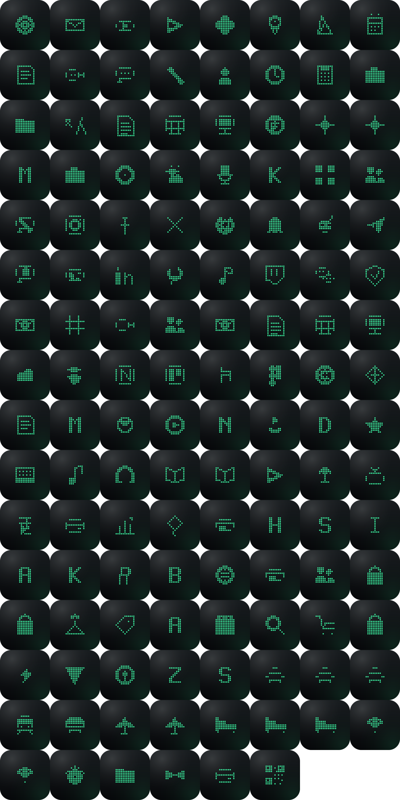
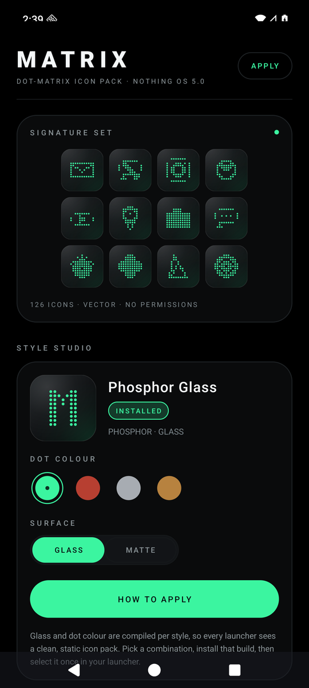
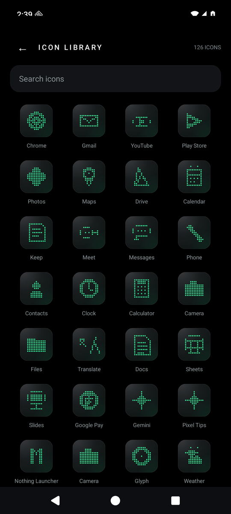

# Matrix · Dot-Matrix Icon Pack for Nothing OS

A premium dot-matrix icon system for Android. Hand-authored 13×13 dot glyphs, rendered as
crisp VectorDrawables, with a glass or flat finish and four signal colours.

Made for the Nothing OS look. Works with every launcher that supports the standard
icon-pack protocol.

**[Download the latest release →](https://github.com/vijaykumarbs/matrix-nothing-iconpack/releases/latest)** · **[Live style picker ↗](https://vijaykumarbs.github.io/matrix-nothing-iconpack/)**

| | |
|---|---|
| Icons | 126 curated apps (Google, Nothing, social, finance, travel, tools) |
| Styles | 8 APKs · Phosphor / Ember / Ice / Amber × Glass / Flat |
| Android | 8.0+ (API 26), tuned for Android 17 / Nothing OS 5.0 |
| Size | ≈ 210 KB per style |
| Permissions | **None** |
| Network | **None** — no Internet permission, no analytics, no trackers |
| Price | Free, MIT licensed |



| Style studio | Icon library |
|---|---|
|  |  |

## Download

Each style is a separate APK so launchers can read a single static `appfilter.xml` —
that is the only format they reliably support. Pick one, install it, apply it.

| Style | Finish | APK |
|---|---|---|
| Phosphor | Glass | [matrix-phosphor-glass.apk](https://github.com/vijaykumarbs/matrix-nothing-iconpack/releases/latest/download/matrix-phosphor-glass.apk) |
| Phosphor | Flat | [matrix-phosphor-flat.apk](https://github.com/vijaykumarbs/matrix-nothing-iconpack/releases/latest/download/matrix-phosphor-flat.apk) |
| Ember | Glass | [matrix-ember-glass.apk](https://github.com/vijaykumarbs/matrix-nothing-iconpack/releases/latest/download/matrix-ember-glass.apk) |
| Ember | Flat | [matrix-ember-flat.apk](https://github.com/vijaykumarbs/matrix-nothing-iconpack/releases/latest/download/matrix-ember-flat.apk) |
| Ice | Glass | [matrix-ice-glass.apk](https://github.com/vijaykumarbs/matrix-nothing-iconpack/releases/latest/download/matrix-ice-glass.apk) |
| Ice | Flat | [matrix-ice-flat.apk](https://github.com/vijaykumarbs/matrix-nothing-iconpack/releases/latest/download/matrix-ice-flat.apk) |
| Amber | Glass | [matrix-amber-glass.apk](https://github.com/vijaykumarbs/matrix-nothing-iconpack/releases/latest/download/matrix-amber-glass.apk) |
| Amber | Flat | [matrix-amber-flat.apk](https://github.com/vijaykumarbs/matrix-nothing-iconpack/releases/latest/download/matrix-amber-flat.apk) |

Every release also ships `SHA256SUMS.txt`. Verify a download with:

```sh
shasum -a 256 -c SHA256SUMS.txt
```

## Install

1. **Download** the style you want on your phone.
2. **Install it.** If Android asks, allow installs from your browser or file manager.
3. **Open Matrix** and tap *Choose launcher* — the app links straight to the icon-pack
   picker, or shows exactly where it lives in your launcher.
4. **Apply.** Icons update instantly; no restart needed.

The pack's icon glyphs live in `res/xml/appfilter.xml`, the standard read by
Nova, Lawnchair, Smart Launcher, Niagara, Hyperion, Kvaesitso, Apex, ADW and others.

### Launcher guide

| Launcher | Where to apply |
|---|---|
| **Nova** | Settings → Look & feel → Icon style → Icon pack |
| **Lawnchair** | Home settings → General → Icon style → Icon pack |
| **Smart Launcher** | Preferences → Appearance → Icon pack |
| **Niagara** | Settings → Appearance → Icon pack |
| **Hyperion** | Settings → Appearance → Icon pack |
| **Kvaesitso** | Settings → Appearance → Icons → Icon pack |
| **Apex / ADW** | Theme settings → Icon pack |

### Nothing OS 5.0 notes

The stock Nothing Launcher (Nothing OS 5.0 / Android 17) still does not expose a stable
third-party icon-pack picker, and Nothing's own icon shape/theme settings take priority.
Matrix therefore ships through the standard icon-pack protocol:

- **Stock Nothing Launcher** — Nothing's Themed Icons and icon-shape controls remain in
  charge. Use Matrix with a launcher below if you want the full dot-matrix set.
- **Nova / Lawnchair / Niagara / Hyperion / Kvaesitso** — full 126-icon coverage, and the
  pack appears in the launcher's own icon-pack list.
- **Adaptive icons** — every icon ships background, foreground and monochrome layers, so
  themed-icon modes keep working where a launcher supports them.
- The app itself follows the system dark theme, edge-to-edge insets and display cutouts.

## Design

- **13×13 dot grid.** Every glyph is drawn as one round-cap stroke path per dot
  (`M x,y h.01`), so an icon is a single tiny vector instead of hundreds of paths.
- **8 finishes.** The accent colour and glass layer are baked into each style APK, which
  is what makes the look consistent across every launcher.
- **Palette.** Phosphor `#3BF5A0` · Ember `#FF5540` · Ice `#E9F0F6` · Amber `#FFB454`.
- **Nothing-grade restraint.** Monochrome tile, no gradients-as-crutch, no drop shadows,
  optical alignment at 108 dp with a 72 dp safe zone.

## Security & privacy

- Zero `uses-permission` entries. No INTERNET, no storage, no package-list permission.
- The only visibility declaration is a narrow `<queries>` for `MAIN`/`LAUNCHER` apps, used
  solely to show which of your apps are covered.
- No background services, receivers, providers or trackers. No WebView.
- Release APKs are signed with a 4096-bit RSA key (APK Signature Scheme v2 + v3) and
  published with SHA-256 checksums.
- The signing key is never committed; CI injects it from encrypted repository secrets.

See [SECURITY.md](SECURITY.md) for the full security model, signing fingerprint and
private vulnerability-reporting process.

## Build

```sh
# Debug, one style
./gradlew :app:assemblePhosphorGlassDebug

# All eight release APKs
./gradlew :app:assembleRelease
```

Requirements: JDK 17+, Android SDK 36, build-tools 36.0.0. The icon resources and Java
tables are generated from source-of-truth data:

```sh
python3 tools/generate.py     # 126 icons × 8 styles → app/src/*/res + Java
python3 tools/preview.py      # glyph contact sheet for design QA
```

Release signing reads `keystore.properties` locally or `MATRIX_KEYSTORE`,
`MATRIX_KEYSTORE_PASSWORD`, `MATRIX_KEY_ALIAS`, `MATRIX_KEY_PASSWORD` in CI.

## Repo layout

```
app/src/main/          UI, manifest, generated icon resources
app/src/<flavor>/res/  per-style colours, tile background, tint wrappers
tools/                 dot-glyph DSL, catalogue, generator, previews
docs/                  landing page + gallery art (GitHub Pages)
```

## License

MIT. Application names and logos referenced in icon-pack metadata belong to their
respective owners. Not affiliated with Nothing Technology Limited or Google LLC.
